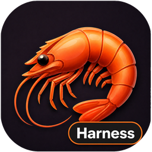
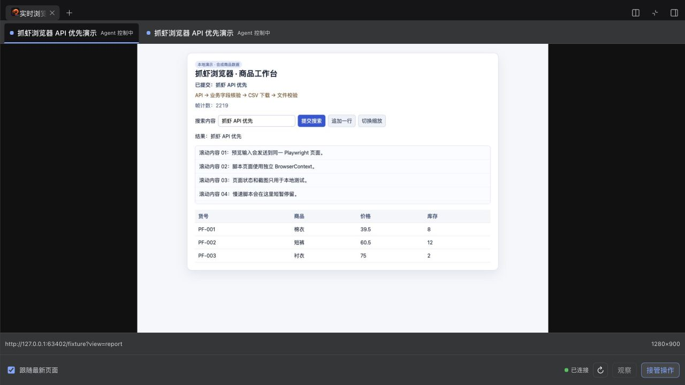

# 抓虾浏览器插件 · DeepSeek Harness（DSH）

**简体中文** | [English](README.en.md)



面向 **DeepSeek Harness（DSH）** 的独立浏览器自动化插件，提供网页操作、实时预览、
多标签页、人工接管和电商页面脚本执行。内置抓虾浏览器 Skill，帮助 Agent 按
“观察 → API 优先执行 → 业务核验 → 流程沉淀”完成采集、填表、上传下载和多阶段任务。

可独立运行，所需环境为 DSH、Node.js 和 Chrome/Chromium；无需抓虾后端。
这是社区插件，由 `dsh-crawshrimp-browser` 单个包提供工具、预览面板、Skill 和抓虾官方图标。

## v0.3.0：API 优先的完整浏览器工作流

- **理解页面再执行**：探查 DOM、框架与端点线索，生成页面模型和策略 bundle。
- **API 优先**：页面模块/客户端调用、同源登录态请求；接口不明确时捕获真实网络证据，再回退 DOM。
- **上传下载**：工作区文件、文件选择器、认证 URL 和点击/blob 下载，返回大小、类型和 SHA-256 回执。
- **结构化核验**：DOM、数量、URL、API 业务字段和文件证据；保存脱敏 session journal。
- **流程复用**：从已验证步骤 distill workflow，或通过 adapter 草稿 → 隔离测试 → 本地发布复用复杂脚本。
- **阶段执行**：phase/page/shared、reload/abort、文件和网络动作，受阶段、分页、时间和输出上限约束。

[Harness 源码能力对照](docs/harness-parity.zh-CN.md) · [完整 Skill 与工具示例](skills/crawshrimp-browser/SKILL.md)

## 界面实测



实际 DSH Web 面板截图，使用本地合成商品页；[人工接管与中文输入效果](docs/screenshots/browser-v030-takeover.png)。

## 快速开始

当前版本：[v0.3.0](https://github.com/howtimeschange/dsh-crawshrimp-browser/releases/tag/v0.3.0)。
适配 **DSH `0.2.1-alpha.4`**，Node.js `^22.19.0 || >=24.0.0`；请先安装 Chrome/Chromium。

使用 DSH 官方插件加载器安装到 Web profile：

```sh
dsh plugin --profile web add -w github:howtimeschange/dsh-crawshrimp-browser#v0.3.0
dsh --profile web
```

在会话中让 Agent 加载 `crawshrimp-browser` Skill，再打开你指定的网页。
从右侧面板的新增/引导菜单选择“实时浏览器”，即可看到实际页面，网页标签横向排列在顶部。
需要人工登录或调整页面时，使用“接管操作”，完成后“恢复 Agent”。

## 适用场景

- **网页自动化**：观察页面、按元素 ref 点击和填表，操作后再次核验结果。
- **电商页面数据采集**：读取商品表格，运行配置好的便携 JavaScript 脚本，校验参数并有界翻页。
- **可见的 Agent 协作**：实时查看网页、多标签切换，人工接管登录或操作，脚本页只读预览。

数据清洗和 CSV/Excel 导出使用[抓虾数据插件](https://github.com/howtimeschange/dsh-crawshrimp-data)；
Word/PowerPoint 文档使用[抓虾 Office 插件](https://github.com/howtimeschange/dsh-crawshrimp-office)。
全部网页自动化集中在本浏览器插件中。

## 能力

插件注册以下工具名：

- `crawshrimp_browser_open`：在新的插件自有页面打开 `http` 或 `https` 地址。
- `crawshrimp_browser_pages`：只列出当前 DSH 会话拥有的页面。
- `crawshrimp_browser_navigate`：把自有页面导航到 `http` 或 `https` 地址。
- `crawshrimp_browser_observe`：返回有长度上限的正文和可操作元素引用。
- `crawshrimp_browser_click`：点击观察结果中的引用或 CSS 选择器。
- `crawshrimp_browser_fill`：向观察结果中的引用或 CSS 选择器填入文本。
- `crawshrimp_browser_select`：按 HTML option 的 `value` 选择选项。
- `crawshrimp_browser_press`：发送 Playwright 按键或 `Modifier+Key` 快捷键。
- `crawshrimp_browser_wait`：等待选择器可见/隐藏，或等待有长度上限的文本。
- `crawshrimp_browser_screenshot`：返回有大小上限的 PNG；纯观察不弹审批。
- `crawshrimp_browser_close`：关闭插件自有页面。
- `crawshrimp_browser_script_list`：发现便携的抓虾脚本适配器。
- `crawshrimp_browser_script_validate`：离线校验任务和参数，不请求审批或启动浏览器。
- `crawshrimp_browser_script_run`：在新建的隔离上下文执行任务脚本并保存 JSON artifact。

新增工具：

| 工具后缀（完整前缀 `crawshrimp_browser_`） | 用途 |
| --- | --- |
| probe | 页面/框架/端点探查与策略 bundle |
| evaluate / request | 有审批的页面 JS / 同源登录态 API 请求 |
| capture_requests | 有界网络证据，可选 reload/click/scroll 触发 |
| upload / download | 工作区文件上传下载与回执 |
| verify / journal | 结构化核验与当前会话证据日志 |
| workflow | 成功步骤沉淀和显式复用 |
| adapter | 草稿、隔离测试、原样本地发布 |

打开、导航、点击、填充、选择、按键、关闭和脚本执行遵循 DSH 原生权限。
选择“完全权限”（`danger-full-access` + `never`）后自动执行，不再额外弹审批。
其他权限组合仍走 DSH 原生审批；单独的 `never` 不代表允许。列页面、观察、等待、截图是只读工具，不弹审批。没有审批服务时会 fail closed；
是否允许调用由 DSH 原生审批策略决定。取消调用会关闭该会话拥有的页面和上下文；
不确定的动作不会自动重试。观察得到的 ref 只在当前 observation 轮次有效，页面更新
或重新观察后应重新获取 ref。

脚本运行遵循相同原生权限映射，并复用插件已经建立的浏览器连接；每次运行都会创建
只属于该运行的新 BrowserContext 和页面，不会使用交互式 DSH 页面。脚本校验是离线的。
脚本支持有上限的翻页以及抓虾兼容的参数、shared-state 全局变量；不支持的后端专用动作和调度声明会被拒绝；受控的文件与网络动作通过同包能力执行。

## 内置抓虾 Skill

同包注册 **crawshrimp-browser** 到 DSH 原生 Skill 目录，Agent 可通过 `skill`
工具加载，也可从技能菜单选择。内容覆盖“观察 → API 优先 → 核验 → 沉淀”、网络探查、上传下载、人工登录接管
和便携脚本复用，只使用本插件工具，不需要单独安装或抓虾后端。最小 CLI 组合没有
Skill 服务时，全部浏览器工具仍可使用。

## DSH Web 实时预览

同一个包内包含 DSH 客户端面板，通过 Chromium CDP 推送**实际 Playwright 页面的画面**，并提供有界截图回退。无需抓虾后端，也没有独立的预览项目。

1. 在 DSH **Web profile** 安装本插件，打开一个会话。
2. 让 Agent 调用 `crawshrimp_browser_open` 打开网页，或运行已配置的便携脚本。
3. 在右侧面板的新增/引导菜单选择**实时浏览器**。顶部横向网页标签只显示当前会话；开启“跟随最新页面”会自动选择新建页面。
4. 点击**接管操作**后，可以在交互页面点击、拖动、滚动、输入和粘贴。接管期间，该页面的 Agent 写操作会被拒绝；点击**恢复 Agent**归还控制。仅观看画面不会取得输入权。
5. 脚本运行页带有运行标识，支持只读观看；运行结束或取消后自动移除，交互页面仍保持独立。

面板使用 DSH 自带的停靠/浮动标签布局。切页、隐藏、失焦或断线会释放人工控制；重连只恢复观察。WebSocket 复用 DSH 宿主的 Host/Origin 检查和签名浏览器身份校验，仅接受 owner 身份。面板不会获得原始 CDP 地址或 storage-state 文件内容。

`previewEnabled` 默认 `true`，设为 `false` 可禁用预览注册。纯 CLI profile 保留全部工具；预览需要 Web profile 的原生 `connection` 和 `webServer` 服务，并仍需安装 Chrome/Chromium。[原实现审计与设计](docs/live-preview-architecture.zh-CN.md)记录了抽离依据和生命周期约定。

## 浏览器前置条件

包内只包含 Playwright 驱动，不包含浏览器二进制文件。请在机器上安装 Chrome 或
Chromium，并配置 `executablePath` 或 `channel`。macOS 默认使用系统 Chrome
（`channel: chrome`）；CI 如果没有 Chrome channel，可通过 `CHROME_PATH` 设置
`executablePath`。也可以设置 `cdpEndpoint`，但插件仍会创建自己的新上下文；卸载
时只断开连接，不关闭外部浏览器。

## 使用 DSH 官方插件加载器安装

仓库按 GitHub 安装方式准备，没有假定已经发布 npm 包：

```sh
dsh plugin --profile web add -w github:howtimeschange/dsh-crawshrimp-browser#v0.3.0
```

本地验证：

```sh
git clone https://github.com/howtimeschange/dsh-crawshrimp-browser.git
cd dsh-crawshrimp-browser
npm ci
dsh plugin --profile demo add -w .
```

加载器会读取 `package.json` 中的 `dsh.bundle.patch`，并应用包内的
`cordis.patch.yml`。它生成的配置项等价于：

```yaml
- id: crawshrimp-browser
  name: dsh-crawshrimp-browser
  config:
    channel: chrome
    headless: true
    adapterRoots:
      - /absolute/path/to/adapters
    workspaceDir: /absolute/path/to/dsh-crawshrimp-browser
    maxPages: 1
    scriptTimeoutMs: 120000
    maxScriptBytes: 524288
    maxOutputBytes: 2097152
```

如需指定浏览器可执行文件，可在 profile overlay 中使用绝对路径：

```yaml
- id: crawshrimp-browser
  name: dsh-crawshrimp-browser
  config:
    executablePath: !!js process.env.CHROME_PATH ?? ''
    channel: chrome
    headless: true
```

`executablePath` 优先于 `channel`；主机提供 Chromium 时可使用
`channel: chromium`。用户管理的 Chrome 可通过 `cdpEndpoint`（例如
`http://127.0.0.1:9222`）连接，但插件不会采用其中已有的上下文或页面。
需要人工登录时可以设置 `headless: false`，登录发生在插件自有的 DSH 会话上下文
中；会话结束时该上下文一并释放，插件不会加载或持久化共享的 Chrome 配置目录。

如果用户已经通过 Playwright 导出登录状态，可以把 `storageStatePath` 配置为私有的
JSON 文件路径。文件只读使用，必须是普通文件且不超过 5 MiB；每个新建的 DSH 会话
都会加载它：

```yaml
- id: crawshrimp-browser
  name: dsh-crawshrimp-browser
  config:
    channel: chrome
    headless: true
    storageStatePath: /absolute/path/to/private/storage-state.json
```

默认值为空。浏览器工具不会返回 cookie、token 或 storage state 内容。文件不存在、
不可读、超过大小限制或 JSON 格式错误时，会以明确错误拒绝创建会话。

## 便携脚本适配器

每个适配器目录包含严格的 `manifest.yaml` 和一个或多个相对路径 `.js` 任务脚本。支持
的 manifest 字段包括 `id`、`name`、`version`、`description`、`author`、`entry_url`、
`skip_auth`、`trigger: { type: manual }` 和 `tasks`。任务可以覆盖 `entry_url`，并使用
`text`、`textarea`、`number`、`select`、`radio`、`checkbox` 或 `date` 声明 `params`。
文件、目录、模型链等后端专用控件会返回迁移诊断；不声明 `params` 的任务保持旧行为，
可以接收任意 JSON 对象。

任务脚本必须是返回 `{ success, data, meta }` 的 async IIFE。运行时把同一个 JSON-clone
对象注入 `window.__PARAMS__` 和 `window.__CRAWSHRIMP_PARAMS__`，并注入
`window.__CRAWSHRIMP_PAGE__`、`window.__CRAWSHRIMP_PHASE__` 和
`window.__CRAWSHRIMP_SHARED__`。返回 `meta.has_more: true` 会在同一页面再次执行，运行时
会传递 `meta.shared` 并合并 `data`。`maxPages` 范围为 1–100，单次运行可以用 `max_pages`
覆盖。支持 `next_phase`、`reload_page`、`abort` 和受控文件/网络动作；每页阶段默认最多 20 次，单次可用 `max_phases` 调整，上限 200。详见[阶段协议](skills/crawshrimp-browser/references/runtime.md)。

可以从[示例适配器](examples/demo-adapter)开始，并使用
`node examples/save-storage-state.js` 辅助程序保存登录状态。storage-state 文件应保存在
私有目录，不要提交到源码仓库。

## 开发验证

```sh
npm ci
npm run check
npm test
npm pack --dry-run
```

测试会启动真实的无头 Chrome，并访问本地合成页面；不会访问真实电商站点或账号。
可用 `CHROME_PATH` 覆盖测试使用的 Chrome 路径。

## 功能划分与迁移

浏览器包统一负责全部网页工作，包含便携页面脚本。[数据包](https://github.com/howtimeschange/dsh-crawshrimp-data)负责记录/表格清洗，[Office 包](https://github.com/howtimeschange/dsh-crawshrimp-office)负责文档。三个包均可独立运行。

原 Scripts 用户请按[迁移指南](docs/migration-from-scripts.md)升级。[功能划分](docs/functional-map.zh-CN.md)记录了早期路线图；v0.3.0 已在 Browser 中提供页面探查、网络证据和上传下载，最新状态以[源码能力对照](docs/harness-parity.zh-CN.md)为准。

0.2.0 增加内置抓虾 Skill、完全权限自动执行、顶部标签实时预览/人工接管、页面管理、导航、下拉选择、按键、等待、显式登录态，以及合并后的脚本校验、参数和有界翻页能力。

0.2.1 统一封装抓虾官方图标，并用于 DSH 插件卡片、实时浏览器标签和引导入口。
